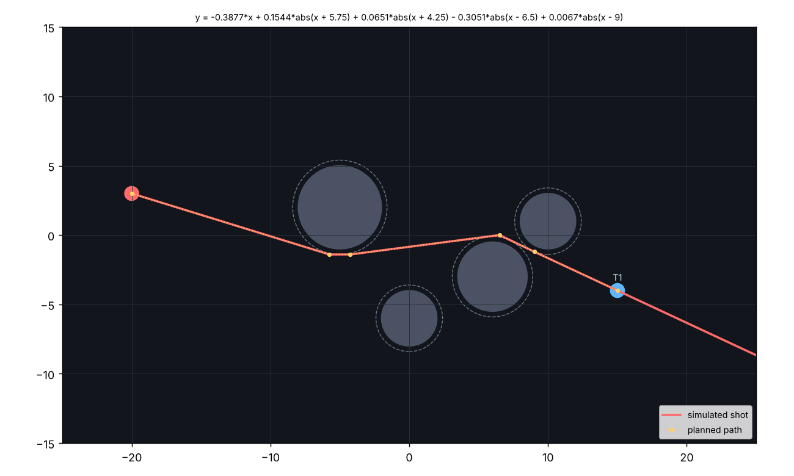
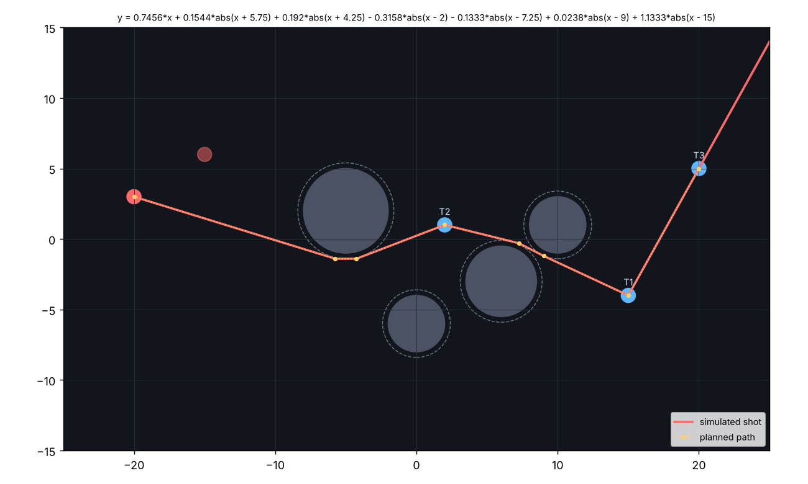
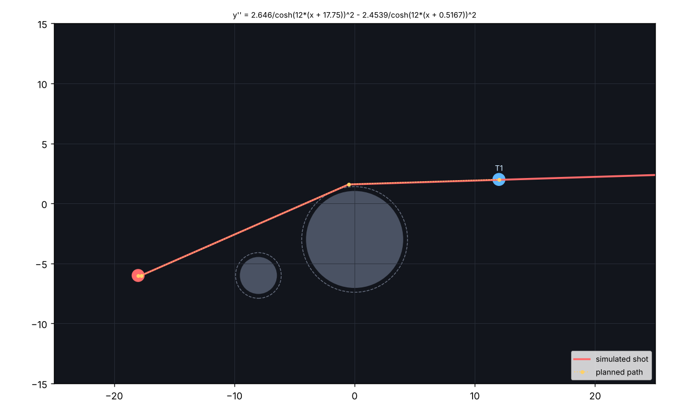

# `calculate.py` — shot calculator

`calculate.py` finds a Graphwar function that carries your shot from your soldier
through **one or more targets** without touching any obstacle. You describe the board
(your soldier, the targets and the obstacle circles), and it prints a function to type
into the game. With several targets it hits all of them when it can; if some can't be
reached, it hits as many as possible and tells you why the others were missed.

Before printing anything, the script runs the function through a Python copy of the
game's own parser and shot simulator (`public/shared.js`). So the result has already
been shown to hit the targets, on the board as you described it.



---

## Contents

1. [Requirements](#requirements)
2. [Quick start](#quick-start)
3. [Reading coordinates from the game](#reading-coordinates-from-the-game)
4. [Command-line options](#command-line-options)
5. [Understanding the output](#understanding-the-output)
6. [Examples](#examples)
7. [How it works](#how-it-works)
8. [The formulas for each mode](#the-formulas-for-each-mode)
9. [Limitations](#limitations)
10. [Troubleshooting](#troubleshooting)
11. [Using it from Python](#using-it-from-python)

---

## Requirements

| Needed     | For                                                           |
|------------|---------------------------------------------------------------|
| Python 3.8+ | running the script                                           |
| numpy      | path planning and the obstacle mask (`pip3 install numpy`)    |
| matplotlib | optional, only for `--plot` (`pip3 install matplotlib`)       |

The script uses nothing else. It doesn't need the game server to be running.

---

## Quick start

```bash
cd graphwar/web
python3 calculate.py --shooter -20,3 --target 15,-4 \
    --circle -5,2,3 --circle 6,-3,2.5 --circle 0,-6,2 --circle 10,1,2
```

```
  y = -0.3877*x + 0.1544*abs(x + 5.75) + 0.0651*abs(x + 4.25) - 0.3051*abs(x - 6.5) + 0.0067*abs(x - 9)

  path   : (-20.00, 3.00)  ->  (-5.75, -1.40)  ->  (-4.25, -1.40)  ->  (6.50, -0.00)  ->  (9.00, -1.20)  ->  (15.00, -4.00)
  length : 97 / 300 characters
  targets: 1 of 1 hit
    T1 (15.00, -4.00): HIT
  closest: 0.40 units from an obstacle on the way
  after  : shot left the board
```

Copy everything after `y =` into the game's function box and fire.

To aim at several soldiers with one shot, repeat `--target`:

```bash
python3 calculate.py --shooter -20,3 --target 2,1 --target 15,-4 --target 20,5 \
    --circle -5,2,3 --circle 6,-3,2.5 --circle 0,-6,2 --circle 10,1,2
```

If you'd rather not type options, run `python3 calculate.py` with no arguments. It asks
for each value one at a time:

```
Graphwar shot calculator - use the coordinates shown on your own screen.

Mode [y / dy / d2y] (default y):
Your soldier x,y: -20,3
Targets as x,y - one per line, empty line to finish:
  target: 15,-4
  target: 2,1
  target:
Obstacles as x,y,r - one per line, empty line to finish:
  circle: -5,2,3
  circle: 6,-3,2.5
  circle:
Teammates to avoid as x,y (optional, empty line to finish):
  friend:
```

---

## Reading coordinates from the game

- **Use the coordinates on your own screen.** Hovering over (or tapping) the board shows
  `(x, y)` in your own view. In that view your team is always on the left and every shot
  travels to the right, so a target must have a **larger x** than your soldier.
  Players on team 2 see a mirrored board, but because the readout is in their own view,
  nothing extra is needed.
- **The board** runs from x = −25 to 25 and y = −15 to 15. Grid lines are 1 unit apart,
  with brighter lines every 5 units.
- **Obstacles** are circles. Each one shows a dot at its centre and its radius (`r=2.78`)
  just below it. Hover over the dot to read `x,y`, then type `--circle x,y,r`.
  Overlapping rocks are separate circles, each with its own dot and label.
- **All circles at once:** open the browser console during a game (F12 → Console, or
  ⌥⌘J on a Mac) and type `circles()`. It prints a table of every obstacle in your own view
  and one line of `--circle x,y,r …` options to paste after `python3 calculate.py`.
  The radius is rounded **up** to 2 decimals, so it can be 0.01 larger than the board label.
- **All targets at once:** type `targets()` in the same console. It prints a table of every
  living enemy soldier (with its player's name) in your own view, and one line of
  `--target x,y …` options. Delete the ones you don't want to aim at. Together:

  ```bash
  python3 calculate.py --shooter <your soldier> <paste targets()> <paste circles()>
  ```
- **Soldiers** have a radius of 0.5. A shot hits a soldier if it passes within 0.5 units of
  the soldier's centre.

---

## Command-line options

| Option | Value | Default | Meaning |
|---|---|---|---|
| `--mode` | `y`, `dy`, `d2y` | `y` | Which box the game is using: `y =`, `y' =` or `y'' =`. The host chooses this when creating the game. |
| `--shooter` | `x,y` | asked | Your soldier whose turn it is (the one with the pulsing ring). |
| `--target` | `x,y` | asked | An enemy soldier to hit. **Repeat for several targets**; they are numbered T1, T2, … in the order given. The order doesn't affect the result; the shot always reaches them from left to right. |
| `--circle` | `x,y,r` | none | An obstacle. Repeat for each one. Only the circles that could be in the way matter. |
| `--friend` | `x,y` | none | A teammate. The path stays clear of them. Repeat as needed. |
| `--enemy` | `x,y` | none | Another enemy. The path doesn't aim at it, but the report tells you if it's hit too. (To aim at it, make it a `--target`.) |
| `--margin` | units | `0.4` | How far the path must stay from obstacles. Increase it if your circle estimates are rough. |
| `--max-slope` | number | `8` | The steepest segment the path may use. |
| `--check` | function | none | Don't calculate anything; just simulate this function and report what it hits. |
| `--plot` | `file.png` | none | Save a picture of the board, the planned path and the simulated shot. |

Negative values work directly after the option (`--shooter -20,3`). Parentheses and
spaces are allowed: `--circle "(-5, 2, 3)"`.

**Exit code:** `0` = every target hit, `2` = some targets hit, `1` = no target hit or
friendly fire. This makes the script usable from other scripts.

---

## Understanding the output

| Line | Meaning |
|---|---|
| `y = …` / `y' = …` / `y'' = …` | The function to type. The label matches the game's mode. |
| `path` | The corner points of the planned path, in your screen coordinates. For `d2y` the second point is the short flat start (see below). |
| `length` | Length in characters. The game rejects functions over 300. |
| `targets` | How many targets the simulated shot hits, then one line per target: `HIT`, or `missed` with the reason (see below). |
| `WARNING` | The shot would hit a teammate given with `--friend`. |
| `bonus` | Other `--enemy` soldiers the shot also hits. |
| `closest` | Closest distance from the shot to any obstacle before it reaches the last target it hits. A negative number means it touches one. |
| `after` | What happens after the last target: leaves the board, hits an obstacle (making a crater), fizzles, or stops at a discontinuity. |
| `note` | Shown only when the script had to use a smaller margin than you asked for to fit through a gap. Double-check your circle sizes before firing. |

Reasons a target can be missed:

| Reason | Meaning |
|---|---|
| `obstacles block every path to it` | Even on its own, with the smallest margin, no rightward path reaches it. |
| `can't be hit on the same curve as the others` | It could be reached alone, but not together with the targets that were hit, e.g. two targets at the same x but far apart in y, or one above and one below a rock with no room to switch. Run again with only that target if it matters more. |
| `it is not to the right of your soldier` | Shots only travel right, so it can never be hit from this soldier. |

`--check` uses the same lines, without `path` and `length`.

---

## Examples

### Several targets in one shot

```bash
python3 calculate.py --shooter -20,3 --target 15,-4 --target 2,1 --target 20,5 \
    --circle -5,2,3 --circle 6,-3,2.5 --circle 0,-6,2 --circle 10,1,2 --friend -15,6
```

```
  y = 0.7456*x + 0.1544*abs(x + 5.75) + 0.192*abs(x + 4.25) - 0.3158*abs(x - 2) - 0.1333*abs(x - 7.25) + 0.0238*abs(x - 9) + 1.1333*abs(x - 15)

  targets: 3 of 3 hit
    T1 (15.00, -4.00): HIT
    T2 (2.00, 1.00): HIT
    T3 (20.00, 5.00): HIT
```



### When not every target can be hit

Here a wall of rocks at x ≈ 5 hides T2:

```bash
python3 calculate.py --shooter -20,0 --target -5,6 --target 15,0 --target -10,-4 \
    --circle 5,-10,5.5 --circle 5,0,5.5 --circle 5,10,5.5
```

```
  y = 0.8*x + 1.2*abs(x + 10)

  targets: 2 of 3 hit
    T1 (-5.00, 6.00): HIT
    T2 (15.00, 0.00): missed - obstacles block every path to it
    T3 (-10.00, -4.00): HIT
```

The exit code is `2` (some targets hit).

### Avoiding a teammate and reporting extra hits

```bash
python3 calculate.py --shooter -20,3 --target 15,-4 \
    --circle -5,2,3 --circle 6,-3,2.5 --circle 0,-6,2 --circle 10,1,2 \
    --friend -15,6 --enemy 20,-6
```

### `y'' =` mode

```bash
python3 calculate.py --mode d2y --shooter -18,-6 --target 12,2 \
    --circle 0,-3,4 --circle -8,-6,1.5 --plot shot.png
```

```
  y'' = 2.646/cosh(12*(x + 17.75))^2 - 2.4539/cosh(12*(x + 0.5167))^2

  path   : (-18.00, -6.00)  ->  (-17.72, -6.00)  ->  (-0.49, 1.60)  ->  (12.00, 2.00)
  targets: 1 of 1 hit
```



### Testing your own function

```bash
python3 calculate.py --check "0.1x" --shooter -20,3 --target 15,-4 --circle -5,2,3
```

```
  y = 0.1x

  targets: 0 of 1 hit
    T1 (15.00, -4.00): missed
  closest: -0.02 units from an obstacle on the way
  after  : shot hit an obstacle at (-6.88, 4.31)
```

If the game would reject the function (a typo, or `y` used in `y =` mode), `--check`
prints the same error message the game shows.

---

## How it works

```
 your input ──► 1. plan path ──► 2. remove extra corners ──► 3. write formula ──► 4. simulate ──► output
                     ▲                                                               │
                     └──────────── retry with a different margin / precision ◄── miss ┘
```

### 1. Plan the path (`plan`)

The space between your soldier and the furthest target is divided into columns about
0.25 units wide, with a column placed exactly at every target's x. Each column has
candidate heights every 0.1 units, from y = −14.8 to 14.8.
The script then finds the path that **passes through the most targets** and, among
those, is the **shortest**. The path:

- starts exactly at your soldier and ends at the last target it passes through,
- passes a target when it crosses that target's column within 0.15 units of its centre
  (it is then moved exactly onto the centre). Each target passed is worth a 1000-unit
  bonus, so one more target always beats any amount of extra length,
- moves one column to the right at every step, so it is always a graph *y(x)*, which is
  the only kind of curve the game can fire,
- never gets closer to an obstacle (or teammate) than `--margin`, checked at every point and
  at four points along each segment,
- is never steeper than `--max-slope`.

Near the shooter and the targets the required gap shrinks, down to 0.06 units, so a soldier
standing right next to a rock can still be reached.

The calculation goes left to right, one column at a time. At each column it keeps, for every
height, the best way to get there (most targets, then shortest). This is dynamic programming,
so it considers every possible path but still takes only about a second.

If no path reaches even one target, the script reports **No path found**.

### 2. Remove extra corners (`simplify`)

The column-by-column path has a small bend at almost every step. Starting from the
shooter, the script draws a straight line to the furthest point along the path that it
can reach without getting closer than the margin to an obstacle (checked every
0.03 units). That point becomes the next corner, and it repeats until it reaches the
end. **Targets are always kept as corners**, so the shortcuts can never skip past one.
The result is usually 1–6 straight segments per target, which keeps the function short.

### 3. Write the formula (`build_expr`)

The straight segments are turned into a function for the chosen mode. The maths is in
[the next section](#the-formulas-for-each-mode).

### 4. Simulate the shot (`check`)

The function is run through Python copies of the game code:

- **`parse` / `compile_function`**: the game's parser, including implicit multiplication,
  which variables each mode allows, the 300-character limit, and JavaScript number
  behaviour (dividing by zero gives ±∞, `sqrt(-1)` gives NaN, and so on).
- **`make_mask` / `mask_at`**: the game's 770 × 450 pixel obstacle grid, built from your circles.
- **`simulate`**: the game's `simulateShot`: the same step sizes, the same RK4 integration
  for the differential-equation modes, the same "fizzle" and "discontinuity" rules, and the same
  0.5-unit hit radius.

The result is accepted when it hits every target and no teammate. Otherwise the script
tries again: a larger margin (+0.2, +0.4) if the shot didn't follow the planned path,
then a smaller one (½ × margin, then 0.08) if some targets were out of reach. It keeps
whichever attempt hits the most targets without friendly fire. Finally, each missed target
is tested on its own to decide between "blocked" and "can't be hit on the same curve".
It also tries fewer decimal places (4 → 3 → 2) if the function is too long, and for `d2y`,
other bend sharpnesses (k = 12, 8, 20).

I checked the copied code against the real `shared.js` in Node, and it gives the same
hits and blast points.

---

## The formulas for each mode

The planned path is a series of straight segments through the points
(x₀, y₀) → (x₁, y₁) → … → (xₙ, yₙ), where (x₀, y₀) is your soldier and (xₙ, yₙ) is the last
target. Targets in the middle are just corners like any other.
Each segment has a slope sᵢ = (yᵢ₊₁ − yᵢ) / (xᵢ₊₁ − xᵢ).

### `y =` mode: corners from `abs`

`|x − c|` has a corner at c, where its slope jumps from −1 to +1. Adding one `abs` term per
corner gives a line made of straight pieces with exactly the slopes needed:

$$
f(x) = B\,x + \sum_{i=1}^{n-1} c_i\,|x - x_i|,\qquad
c_i = \frac{s_i - s_{i-1}}{2},\qquad
B = \frac{s_0 + s_{n-1}}{2}
$$

The game draws f(x) − f(x₀) + y₀, so the curve always starts at your soldier and no
constant term is needed. After the last target the shot keeps going with the last slope.
This mode follows the planned path **exactly**.

### `y' =` mode: slopes from `sign`

The slope of `|x − c|` is `sign(x − c)`, so the function to type is the slope of the formula above:

$$
y' = B + \sum_{i=1}^{n-1} c_i\,\operatorname{sign}(x - x_i)
$$

The game integrates this starting from your soldier, which gives back the same path.
The sudden slope changes add a small error at each corner (well under 0.1 units), and the
simulation step includes it.

### `y'' =` mode: smooth bends from `cosh`

In this mode the game always starts the shot with slope 0, and the only thing you can set
is how the slope changes. Each corner where the slope changes by Δsᵢ becomes a narrow
bump of curvature:

$$
y'' = \sum_i \frac{a_i}{\cosh^2\!\big(k\,(x - x_i + \delta)\big)},\qquad
a_i = \frac{k\,\Delta s_i}{2},\qquad \delta = \frac{\ln 2}{2k}
$$

- One bump adds exactly Δsᵢ to the slope (the area under it is Δsᵢ).
- k sets how sharp the bend is: the bend is about 1/k units wide. The default is
  k = 12, a width of about 0.08.
- A smooth bend ends up slightly behind a sharp corner, by Δsᵢ·δ in height. Moving each
  bump δ to the left cancels this, so after the bend the shot is back on the planned line.
- Because the shot must leave flat, the path starts with a short **flat lead-in** of length
  3/k + δ (≈ 0.28 units). The first bump then turns the shot onto its first slope. That
  is the extra point you see second in `path`.

The bends round off corners slightly, by up to about 0.03·Δs units, which the margin covers.

---

## Limitations

- **Shots can only move right.** If rocks completely block every rightward route to the
  target, there is no solution. Pick another target or wait for your next soldier.
- **The board you describe is what gets checked.** If a circle's position or size is off,
  the check can pass while the real shot doesn't. The default 0.4 margin covers small
  estimation errors; use `--margin 0.6`–`0.8` if you're unsure.
- **Obstacles are circles only.** In this version of the game every obstacle is a circle,
  but overlapping circles can look like one irregular rock. Enter each circle separately.
- **Craters are ignored.** Holes from earlier blasts only make the board more open, so
  ignoring them can only make the planned path more cautious, never cause a miss.
- **Targets are equally important.** The script maximises how many targets are hit, not
  which ones. If one target matters more, run it with that target alone first.
- **Many targets mean longer functions.** Each target adds corners. If the function would
  exceed 300 characters, the script uses fewer decimal places; in extreme cases, give
  fewer targets.
- **The shortest path stays close to obstacles.** It typically passes exactly `margin`
  units from rocks, not through the middle of a gap.

---

## Troubleshooting

| Message | Cause | What to do |
|---|---|---|
| `Shots only travel to the right…` | The target's x isn't larger than the shooter's. | Use the coordinates from your own screen (players on team 2 see a mirrored board). |
| `No path found…` | Obstacles block every rightward route to every target, even at a 0.08 margin. | Check the circle sizes; choose other targets. |
| `missed - can't be hit on the same curve…` | That target conflicts with the others. | Run with that target alone, or accept the targets that were hit. |
| `note: had to squeeze to a … margin` | The only route is a narrow gap. | Measure the nearby circles more carefully, or accept the risk. |
| `Best attempt did NOT pass the check` | No attempt hit a target without friendly fire (rare). | Try `--max-slope 12`, a different mode, or check the inputs. |
| `The game would reject this function: …` | `--check` was given something the game can't parse. | Fix the function as the message says. |
| `calculate.py needs numpy` | numpy isn't installed. | `pip3 install numpy` |
| `matplotlib not installed - skipping the plot` | `--plot` without matplotlib. | `pip3 install matplotlib`, or leave out `--plot`. |

---

## Using it from Python

The script can also be imported:

```python
from calculate import solve, check, make_mask

res = solve(mode="y", shooter=(-20, 3), targets=[(15, -4), (2, 1)],
            circles=[(-5, 2, 3), (6, -3, 2.5)], friends=[], enemies=[],
            margin=0.4, max_slope=8)
print(res["expr"], res["ok"], res["targets_hit"])

# simulate any function the way the game would
r = check("0.2x", "y", (-20, 3), [(15, -4)], [(-5, 2, 3)], [], [], make_mask([(-5, 2, 3)]))
print(r["targets_hit"], r["end"])
```

`solve` returns `None` if no target can be reached. Otherwise it returns a dictionary with:

| Key | Meaning |
|---|---|
| `expr` | The function to type |
| `knots` | Corner points of the planned path |
| `ok` | `True` when every target is hit and no teammate |
| `targets_hit` | Indices (0-based) of the targets the simulated shot hits |
| `planned` | Indices of the targets the path was planned through |
| `blocked` | Indices of missed targets that no path can reach |
| `friendly_fire`, `bonus` | Teammates / extra enemies hit (`friend1`, `enemy2`, …) |
| `clearance` | Closest distance to an obstacle up to the last target hit |
| `margin` | Margin actually used |
| `end`, `points`, `hits`, `explosion` | How the shot ended, its path, all hits and the blast point |

| Function | Purpose |
|---|---|
| `parse`, `compile_function` | The game's expression parser |
| `make_mask`, `mask_at` | Obstacle grid |
| `simulate` | The game's `simulateShot`, as seen by the shooter |
| `make_clear`, `plan`, `simplify` | Path planning (through several targets, keeping them as corners) |
| `build_expr` | Straight segments → function for each mode |
| `check`, `solve` | Simulate one function / full search with retries |
